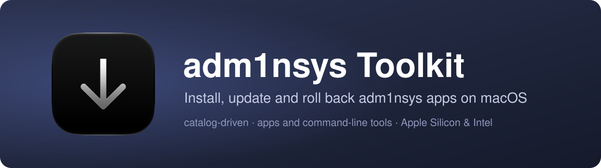
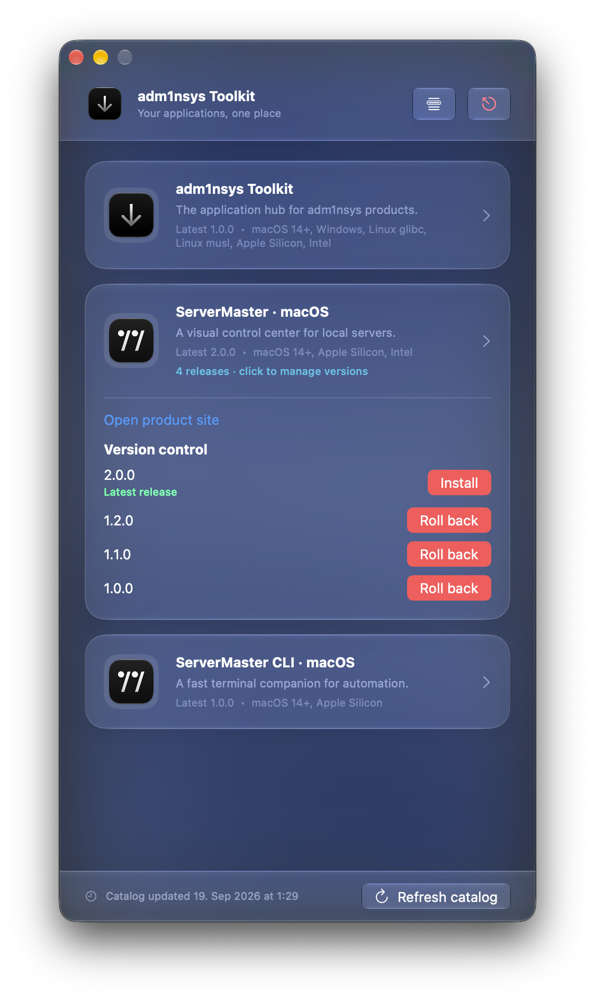

<p align="center"></p>

[](https://github.com/adm1nsys/ToolKit/actions/workflows/toolkit-ci.yml)
[](https://adm1nsys.github.io/ToolKit/)

A macOS app that installs, updates and rolls back my applications and command-line tools from one window. It reads a catalog from this repository, so new products and releases appear without a new version of the app.

<p align="center"></p>

## Download

**[adm1nsys Toolkit for macOS](https://github.com/adm1nsys/ToolKit/releases/latest)** — macOS 14 or newer, Apple Silicon and Intel.

The app is not notarized, so macOS blocks the first start; the [installation guide](https://adm1nsys.github.io/ToolKit/gatekeeper.html) shows how to allow it.

## What it does

- Shows every product in the catalog, which ones are installed and in which version — even offline, from a built-in fallback catalog
- Installs the latest release, or any older one; several versions can stay installed side by side for rollback
- Hides products that do not support this Mac (OS version, CPU architecture)
- Saves any release archive to a place of your choice instead of installing it

## Where things go

| Product type | Installed to | Found by |
|---|---|---|
| App | `/Applications/<Name>.app` (older versions as `<Name> v1.2.0.app`) | bundle identifier or app name |
| Command-line tool | `~/.local/bin/<executable>` (older versions as `<executable>-v1.0.0`) | the executable in `~/.local/bin`, `/usr/local/bin`, `/opt/homebrew/bin` or `PATH`, asked for its version |

Command-line tools go to `~/.local/bin`: it belongs to the user, needs no administrator rights and stays out of Homebrew's folders. If that folder is not in your `PATH` yet, Toolkit says so after the install:

```bash
echo 'export PATH="$HOME/.local/bin:$PATH"' >> ~/.zshrc
```

Toolkit never removes files that Homebrew manages.

## The catalog

[`catalog.json`](catalog.json) is the source of truth: product metadata, supported platforms, the release history and download links. Each platform variant is its own product card — `targets` lists the operating system, CPU architecture and, for Linux, the C library; `releases` holds the versions for that card. Linux command-line builds have separate cards for glibc and musl. Cards for platforms that are not released yet are marked `soon` and have no download link.

## Repository layout

| Path | Contents |
|---|---|
| [`mac/`](mac) | the SwiftUI app |
| [`catalog.json`](catalog.json) | the catalog the app downloads |
| [`web/`](web) | the website: landing page, installation guide, 404 — deployed to GitHub Pages on every push |
| [`maceditor/`](maceditor) | my editor for `catalog.json`; for maintaining the catalog, not shipped to users |

## Build

```bash
xcodebuild -project mac/Adm1nSysToolkit.xcodeproj -scheme Adm1nSysToolkit \
  -configuration Release ARCHS="arm64 x86_64" ONLY_ACTIVE_ARCH=NO CODE_SIGNING_ALLOWED=NO build
```

GitHub Actions builds the same unsigned universal app on every change in `mac/` and keeps it as a build artifact.
